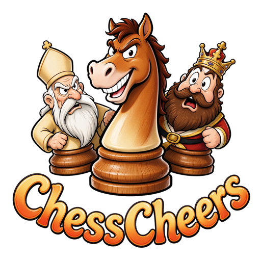
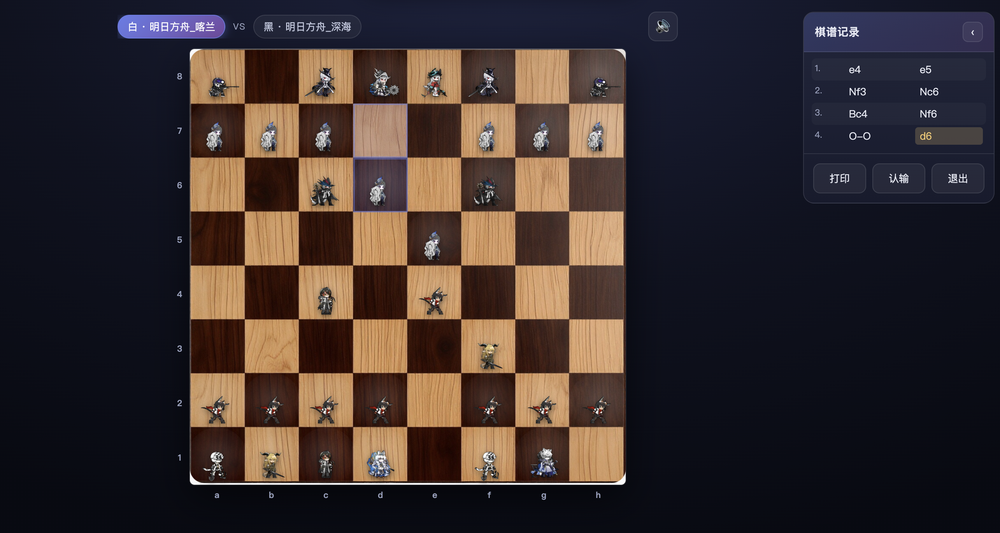

<div align="center">

<a id="top"></a>



# ChessCheers

**定义、选择并率领你的阵营，展开一场国际象棋冒险之旅。**

[](#技术栈)
[](#技术栈)
[](#技术栈)
[](#发布网页版)

[玩法指南](doc/UserGuide.md#part-player) · [开发指南](doc/UserGuide.md#part-dev) · [了解更多](doc/intro/intro_zh.md) · [English](doc/README_en.md)

</div>

---

<a id="about"></a>

## 这是什么

ChessCheers 是一个跑在浏览器里的国际象棋应用，支持**人机对弈**与**同屏双人对弈**。

**它首先是一个同人游戏。** 棋盘上的角色与语音来自手机游戏《明日方舟》，作者出于对该游戏与国际象棋的喜爱而制作，与官方无任何关联。项目底层基于国际象棋引擎 [Stockfish](https://stockfishchess.org/) 完成算棋，用 Chess.js 管理行棋规则。

**其次它是一个通用框架。** 棋子与棋盘全部来自 `data/` 目录下的素材文件——理论上只要按规范替换图片、动画与音频，就能让任何自定义角色与棋盘出现在游戏中，换成你自己的 IP、原创角色乃至纯几何棋子都可以。

> 素材的版权归属与使用限制请见 [许可与声明](#license)。使用或分发前请务必阅读。

<div align="center">

<br>
<sub><strong>注意：概念预览图，真实效果略有不同。</strong></sub>
</div>

想先了解玩法和页面结构？请看 [使用指南 · 公共部分](doc/UserGuide.md#common)。

## 特性

- ♟ **自定义阵营** —— 每个棋子支持「选中 / 落子 / 被吃」三种状态的动画与语音
- 🎨 **自定义棋盘** —— 任意 1:1 图片即可，替换素材就能换掉整套视觉
- 🎬 **动态棋子** —— 走子时棋子从原格平移到目标格，吃子、易位、吃过路兵、升变各有对应表现
- 🤖 **七档 AI 难度** —— 500 分以下到 3000 分以上，映射到不同搜索深度与思考时长
- 📖 **完整规则** —— 将杀、和棋、三次重复、五十回合、王车易位、吃过路兵、兵升变
- 📝 **棋谱导出** —— 标准记谱法实时记录，可导出含对局配置与结算文案的 TXT
- 📱 **响应式** —— PC 与移动端自适应；人机执黑时棋盘自动翻转，己方永远在下方

<a id="quick-start"></a>

## 快速开始

### 方式一：在线访问

打开项目部署地址即可，无需安装任何东西：

```
https://schlampig.github.io/ChessCheers/
```

> 首次打开会稍微慢一点（素材与引擎要下载，之后浏览器会缓存）。

### 方式二：本地启动

浏览器会拦截 `file://` 下的 Web Worker（AI 将无法工作），**必须通过 HTTP 访问**。

```bash
git clone https://github.com/Schlampig/ChessCheers.git
cd ChessCheers

node tools/serve.js          # 默认 http://127.0.0.1:8766/
```

启动时会自动扫描 `data/` 下的素材、校验规范并生成清单，终端会打印每个阵营与棋盘是否合格。

macOS 也可直接双击 `tools/serve.command`。

> 没有 Node.js？装一个，或改用 `python3 -m http.server 8766`（需先手动执行 `node tools/scan-assets.js`）。

更细的说明见 [使用指南 · 怎么打开](doc/UserGuide.md#common-open)。

<a id="assets"></a>

## 使用自己的素材

**棋盘**：把 1:1 的 `png`/`jpg`/`jpeg`/`webp` 丢进 `data/chessboard/`，文件名即显示名。

**阵营**：在 `data/chesspiece/` 下新建文件夹，内含 `King`、`Queen`、`Bishop`、`Knight`、`Rook`、`Pawn` 六个子目录，每个目录放 `选中` / `落子` / `被吃` 三种素材（webm/gif/png/jpg/webp，语音可选）。

**重启服务即生效**。不合规的素材不会出现在网页选项里，终端与首页都会提示原因。

### 建议顺手瘦身

网页版的瓶颈通常在素材体积，而不是代码。仓库自带两个可选工具：

```bash
python3 tools/optimize-assets.py   # 棋盘/结算图转 webp、语音转 m4a（需 Pillow）
node tools/make-posters.js         # 生成棋子静止态预览图（需 Chrome）
```

- **棋盘**建议长边 ≤ 1024、**结算图** ≤ 1600；`optimize-assets.py` 会同时生成首页用的 `-mini` 缩略图
- `make-posters.js` 会把每个棋子的 `选中.webm` 首帧截成 `预览.webp`（几 KB）。
  有了它，棋盘上 32 个棋子静止时只加载图片，视频只在真正播动画时才下载；
  没有预览图也能跑，只是首屏要拉几十 MB 视频，弱网下体验很差

完整规范（目录结构、状态映射、结算素材、logo）见 [使用指南 · 素材规范](doc/UserGuide.md#dev-assets)。

<a id="deploy"></a>

## 发布网页版

这一步是**可选的**：只在自己电脑上玩，本地启动就够了。如果你想把这份游戏发布到自己的域名下，分享给朋友或换设备也能玩，可以部署到**你自己的** GitHub Pages：

1. 把仓库 fork 或推送到你自己的 GitHub 账号
2. 进入仓库 → Settings → Pages → Source 选 `main` 分支、根目录
3. 等待约一分钟，访问 `https://<你的用户名>.github.io/<仓库名>/`

注意事项：

- 部署前执行一次 `node tools/scan-assets.js`，确保素材清单是最新的
- 根目录 `index.html` 负责跳转，`.nojekyll` 用于关闭 Jekyll 处理
- 页面与素材全部使用相对路径，部署到子目录（`/仓库名/`）也能正常工作

详细步骤见 [使用指南 · 发布网页版](doc/UserGuide.md#dev-deploy)。

<a id="stack"></a>

## 技术栈

| 层 | 选型 | 说明 |
|---|---|---|
| 规则 | Chess.js 0.10 | 走法校验、棋谱、胜负判定、FEN 输出 |
| AI | Stockfish（WASM） | 运行在 Web Worker，不阻塞界面 |
| 前端 | HTML5 / CSS3 / 原生 JS | **ES5 语法**，无框架、无构建、无依赖安装 |
| 部署 | GitHub Pages | 纯静态托管 |

<a id="layout"></a>

## 目录结构

```
ChessCheers/
├── index.html              # 部署入口（跳转到 code/html/index.html）
├── code/
│   ├── html/               # 四个页面：index / game / result / about
│   ├── css/                # 与页面一一对应的样式
│   ├── js/
│   │   ├── assets.js       # 素材清单（由 tools/scan-assets.js 生成，勿手改）
│   │   ├── asset-loader.js # 素材解析、棋子构建、音效、logo
│   │   ├── stockfish-engine.js  # 引擎封装与难度映射
│   │   ├── game.js         # 对弈页核心
│   │   ├── chess.min.js    # 第三方：Chess.js
│   │   └── stockfish.wasm*  # 第三方：Stockfish WASM
│   └── test/               # CDP 自动化测试
├── data/                   # 素材
│   ├── chessboard/         # 棋盘（必须 1:1）
│   ├── chesspiece/         # 阵营
│   ├── chesslogo/          # 项目 logo
│   └── others/             # 文档配图
├── doc/                    # 文档（PRD / 使用指南 / 英文 README / intro）
└── tools/                  # 本地服务与素材工具
    ├── serve.js            # 启动即扫描素材的本地服务器
    ├── scan-assets.js      # 素材清单与规范检查
    ├── optimize-assets.py  # 图片转 webp、语音转 m4a（可选）
    ├── make-posters.js     # 生成棋子静止态预览图（可选）
    └── bump-version.js     # 刷新静态资源版本号
```

更细的模块划分与「哪里能改、哪里别动」见 [使用指南 · 第二部分](doc/UserGuide.md#part-dev)。

<a id="license"></a>

## 许可与声明

- **代码**：本项目**仅供学习与交流**，**严禁商业用途**。转载请注明出处。
- **第三方库**：
  - [Chess.js](https://github.com/jhlywa/chess.js) — BSD-2-Clause
  - [Stockfish](https://github.com/official-stockfish/Stockfish) — GPL-3.0
  - [stockfish.wasm](https://github.com/lichess-org/stockfish.wasm) — GPL-3.0
- **素材（`data/` 目录）**：棋子立绘、配音等来自《明日方舟》同人创作与 [PRTS 中文维基](https://prts.wiki/)，版权归原权利方所有，**仅用于个人学习与非商业展示**。如存在不妥或违规，请在 issue 中告知作者，作者将**立即下架相关素材**。
- 本项目与上海鹰角网络科技有限公司无关。

### 引用规范

欢迎引用该项目，或基于该项目进行其他创作，引用格式如下：

- 项目名称：ChessCheers
- 项目地址：https://github.com/Schlampig/ChessCheers
- 项目作者：猪猪熊(PigPigBear/Kuyiking)
- 作者链接：https://github.com/Schlampig

<a id="credits"></a>

## 致谢

- [明日方舟](https://ak.hypergryph.com/)
- [明日方舟 PRTS（Preliminary RodesIsland Terminal System）](https://prts.wiki/index.php?title=%E5%B9%B2%E5%91%98%E4%B8%80%E8%A7%88&oldid=439147)
- [Stockfish（Strong open-source chess engine）](https://stockfishchess.org/)
- [Lichess](https://lichess.org/)

<div align="center">
<sub>如果这个项目对你有帮助，欢迎点个 ⭐</sub>
</div>
