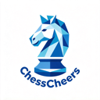

<div align="center">



# ChessCheers

**定义、选择并率领你的阵营，展开一场国际象棋冒险之旅。**

[](#技术栈)
[](#技术栈)
[](#技术栈)
[](#部署)

[玩法指南](UserGuide.md#第一部分给玩家) · [开发指南](UserGuide.md#第二部分给开发者) · [了解更多](code/html/about.html)

</div>

---

## 这是什么

一个**纯前端**的网页版国际象棋：人机对弈 + 同屏双人对弈。

与常见象棋应用最大的不同是——**棋子与棋盘全部可替换**。把素材文件夹放进 `data/`，重启服务，就能用自己的角色、立绘和配音下棋。

底层用 [Chess.js](https://github.com/jhlywa/chess.js) 管规则、[Stockfish](https://stockfishchess.org/)（WASM 版）算棋路，无后端、无构建工具、无需安装依赖。

<div align="center">

</div>

## 特性

- ♟ **自定义阵营** —— 每个棋子支持「选中 / 落子 / 被吃」三种状态的动画与语音
- 🎨 **自定义棋盘** —— 任意 1:1 图片即可
- 🎬 **动态棋子** —— 走子时棋子从原格平移到目标格，吃子、易位、吃过路兵、升变各有对应表现
- 🤖 **七档 AI 难度** —— 500 分以下到 3000 分以上，映射到不同搜索深度与思考时长
- 📖 **完整规则** —— 将杀、和棋、三次重复、五十回合、王车易位、吃过路兵、兵升变
- 📝 **棋谱导出** —— 标准记谱法实时记录，可导出含对局配置与结算文案的 TXT
- 📱 **响应式** —— PC 与移动端自适应；人机执黑时棋盘自动翻转，己方永远在下方

## 快速开始

浏览器会拦截 `file://` 下的 Web Worker（AI 将无法工作），**必须通过 HTTP 访问**。

```bash
git clone <本仓库地址>
cd ChessCheers

node tools/serve.js          # 默认 http://127.0.0.1:8766/
```

启动时会自动扫描 `data/` 下的素材、校验规范并生成清单，终端会打印每个阵营与棋盘是否合格。

macOS 也可直接双击 `tools/serve.command`。

> 没有 Node.js？装一个，或改用 `python3 -m http.server 8766`（需先手动执行 `node tools/scan-assets.js`）。

## 使用自己的素材

**棋盘**：把 1:1 的 `png`/`jpg`/`jpeg` 丢进 `data/chessboard/`，文件名即显示名。

**阵营**：在 `data/chesspiece/` 下新建文件夹，内含 `King`、`Queen`、`Bishop`、`Knight`、`Rook`、`Pawn` 六个子目录，每个目录放 `选中` / `落子` / `被吃` 三种素材（webm/gif/png/jpg，语音可选）。

**重启服务即生效**。不合规的素材不会出现在网页选项里，终端与首页都会提示原因。

完整规范见 [UserGuide · 素材规范](UserGuide.md#素材规范)。

## 部署到 GitHub Pages

1. 推送仓库到 GitHub
2. Settings → Pages → Source 选 `main` 分支、根目录
3. 访问 `https://<用户名>.github.io/<仓库名>/`

根目录的 `index.html` 是部署入口（跳转到 `code/html/index.html`），`.nojekyll` 用于关闭 Jekyll 处理。

> 部署前请执行一次 `node tools/scan-assets.js`，确保素材清单是最新的。

## 技术栈

| 层 | 选型 | 说明 |
|---|---|---|
| 规则 | Chess.js 0.10 | 走法校验、棋谱、胜负判定、FEN 输出 |
| AI | Stockfish（WASM） | 运行在 Web Worker，不阻塞界面 |
| 前端 | HTML5 / CSS3 / 原生 JS | **ES5 语法**，无框架、无构建、无依赖安装 |
| 部署 | GitHub Pages | 纯静态托管 |

## 目录结构

```
ChessCheers/
├── index.html              # 部署入口（跳转到 code/html/index.html）
├── code/
│   ├── html/               # 四个页面：index / game / result / about
│   ├── css/                # 与页面一一对应的样式
│   ├── js/
│   │   ├── assets.js       # 素材清单（由 tools/scan-assets.js 生成，勿手改）
│   │   ├── asset-loader.js # 素材解析、棋子构建、音效、logo
│   │   ├── stockfish-engine.js  # 引擎封装与难度映射
│   │   ├── game.js         # 对弈页核心
│   │   ├── chess.min.js    # 第三方：Chess.js
│   │   └── stockfish.wasm*  # 第三方：Stockfish WASM
│   └── test/               # CDP 自动化测试
├── data/                   # 素材
│   ├── chessboard/         # 棋盘（必须 1:1）
│   ├── chesspiece/         # 阵营
│   └── chesslogo/          # 项目 logo
├── doc/intro/              # 「了解更多」页面的中英文文档
└── tools/                  # 本地服务、素材扫描、版本号工具
```

更细的模块划分与「哪里能改、哪里别动」见 [UserGuide · 第二部分](UserGuide.md#第二部分给开发者)。

## 许可与声明

- **代码**：本项目代码供学习与交流使用，**禁止商业用途**。转载请注明出处。
- **第三方库**：
  - [Chess.js](https://github.com/jhlywa/chess.js) — BSD-2-Clause
  - [Stockfish](https://github.com/official-stockfish/Stockfish) — GPL-3.0
  - [stockfish.wasm](https://github.com/lichess-org/stockfish.wasm) — GPL-3.0
- **素材（`data/` 目录）**：棋子立绘、配音等来自《明日方舟》同人创作与 [PRTS 中文维基](https://prts.wiki/)，版权归原权利方所有，**仅用于个人学习与非商业展示**。如有侵权，请通过 issue 联系，作者会立即下架相关内容。
- 本项目与上海鹰角网络科技有限公司无关。

## 致谢

- 作者：[PigPigBear](https://github.com/Schlampig)（Kuyiking）
- 详见 [了解更多](code/html/about.html) 页面

<div align="center">
<sub>如果这个项目对你有帮助，欢迎点个 ⭐</sub>
</div>
