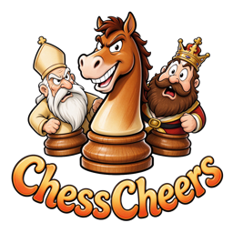
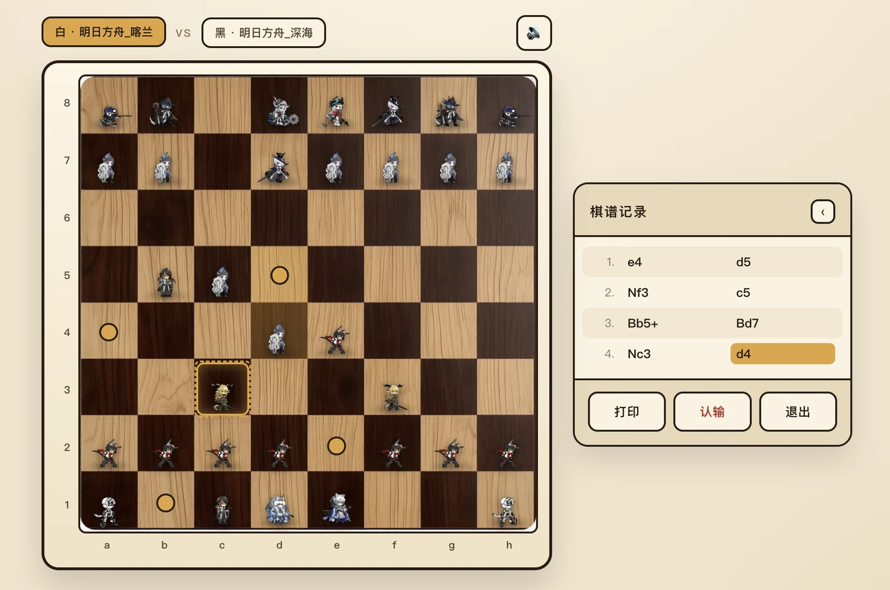

<div align="center">

<a id="top"></a>



# ChessCheers

**Pick a faction, take command, and set off on a chess adventure.**

[](#tech-stack)
[](#tech-stack)
[](#tech-stack)
[](#publishing-a-web-version)

[Player Guide](UserGuide_en.md#part-player) · [Developer Guide](UserGuide_en.md#part-dev) · [Learn More](intro/intro_en.md) · [中文](../README.md)

</div>

---

<a id="about"></a>

## What this is

ChessCheers is a chess application that runs in the browser, supporting **human vs AI** and **two players on one device**.

**First and foremost, it is a fan game.** The characters and voice lines on the board come from the mobile game *Arknights*. The author built it out of a love for that game and for chess; it is not affiliated with the official rights holders in any way. Under the hood, move calculation is powered by the chess engine [Stockfish](https://stockfishchess.org/), and move validation is handled by Chess.js.

**Second, it is a generic framework.** Pieces and boards all come from asset files under `data/`. In principle, as long as you follow the specification and replace the images, animations and audio, you can put any custom characters and boards into the game — your own IP, original characters, or plain geometric pieces.

> For copyright ownership and usage restrictions, see [License and notices](#license). Please read it before using or distributing anything.

<div align="center">

<br>
<sub><strong>Note: concept preview only; the actual game looks slightly different.</strong></sub>
</div>

Want to understand the gameplay and page structure first? See [User Guide · Common](UserGuide_en.md#common).

## Features

- ♟ **Custom factions** — every piece has select / move / capture animations and voice lines
- 🎨 **Custom boards** — any 1:1 image works; swap the assets and the whole look changes
- 🎬 **Animated pieces** — pieces slide from square to square; captures, castling, en passant and promotion each have their own treatment
- 🤖 **Seven AI tiers** — from below 500 to above 3000, mapped to different search depths and thinking times
- 📖 **Complete rules** — checkmate, draws, threefold repetition, fifty-move rule, castling, en passant, promotion
- 📝 **Move export** — standard notation recorded live, exportable as TXT with the game setup and result
- 📱 **Responsive** — adapts to desktop and mobile; when you play black against the AI the board flips, keeping your side at the bottom

<a id="quick-start"></a>

## Quick start

> **Running locally is recommended.** The web version is hosted on GitHub Pages, so the assets and
> the AI engine (about 0.6 MB) are fetched over the network; access speed varies a lot. For a stable
> experience, use Option 1.

### Option 1: Run locally (recommended)

Browsers block Web Workers under `file://` (the AI will not work), so **you must access it over HTTP**.

```bash
git clone https://github.com/Schlampig/ChessCheers.git
cd ChessCheers

node tools/serve.js          # defaults to http://127.0.0.1:8766/
```

On start-up it scans `data/`, validates the assets and regenerates the manifest; the terminal prints whether each faction and board passed.

On macOS you can also double-click `tools/serve.command`.

> No Node.js? Install it, or use `python3 -m http.server 8766` (run `node tools/scan-assets.js` manually first).

### Option 2: Online

If you would rather not install anything, open:

```
https://schlampig.github.io/ChessCheers/
```

> ⚠️ The web version needs a **decent connection** to be enjoyable: the first visit downloads the
> board, the piece posters and the AI engine. On a slow link it may take ten-plus seconds, animations
> lag behind, and you may even hear the voice line without seeing the animation. If that happens,
> switch to Option 1.

More detail in [User Guide · How to open it](UserGuide_en.md#common-open).

<a id="assets"></a>

## Using your own assets

**Boards**: drop a 1:1 `png`/`jpg`/`jpeg`/`webp` into `data/chessboard/`. The filename becomes the display name.

**Factions**: create a folder under `data/chesspiece/` containing six subfolders — `King`, `Queen`, `Bishop`, `Knight`, `Rook`, `Pawn` — each with `选中` / `落子` / `被吃` assets (webm/gif/png/jpg/webp; audio optional).

**Restart the server and it takes effect.** Invalid assets never appear in the dropdown; the terminal and the home page explain why.

### Slimming your assets

On the web, the bottleneck is almost always asset size, not code. Two optional tools ship with the repo:

```bash
python3 tools/optimize-assets.py   # boards/endings → webp, voice → m4a (needs Pillow)
node tools/make-posters.js         # generate idle first-frame posters (needs Chrome)
```

- Keep **boards** ≤ 1024 px and **ending artwork** ≤ 1600 px on the long edge; `optimize-assets.py` also
  emits a `-mini` thumbnail for the home page preview
- `make-posters.js` grabs the first frame of every `选中.webm` into `预览.webp` (a few KB each).
  With posters, the 32 idle pieces load as small images and videos are fetched only when an animation
  actually plays; without them the site still works, but the first load pulls tens of MB of video and
  is painful on a slow link

Full specification (folder layout, state mapping, ending artwork, logo) in [User Guide · Asset specification](UserGuide_en.md#dev-assets).

<a id="publishing-a-web-version"></a>

## Publishing a web version

This step is **optional**: if you only play on your own machine, running locally is enough. If you want to publish the game under your own domain, share it with friends, or play from another device, deploy it to **your own** GitHub Pages:

1. Fork the repository, or push it to your own GitHub account
2. Repository → Settings → Pages → Source: `main` branch, root directory
3. Wait about a minute, then open `https://<your-username>.github.io/<repo-name>/`

Notes:

- Run `node tools/scan-assets.js` once before deploying so the manifest matches the assets
- The root `index.html` handles the redirect; `.nojekyll` disables Jekyll
- All pages and assets use relative paths, so deploying into a subdirectory (`/repo-name/`) works fine

See [User Guide · Publishing a web version](UserGuide_en.md#dev-deploy) for details.

<a id="tech-stack"></a>

## Tech stack

| Layer | Choice | Notes |
|---|---|---|
| Rules | Chess.js 0.10 | Move validation, notation, result detection, FEN output |
| AI | Stockfish (WASM) | Runs in a Web Worker, never blocks the UI |
| Frontend | HTML5 / CSS3 / vanilla JS | **ES5 only**, no framework, no build, no dependencies |
| Deploy | GitHub Pages | Pure static hosting |

<a id="layout"></a>

## Project layout

```
ChessCheers/
├── index.html              # deploy entry (redirects to code/html/index.html)
├── code/
│   ├── html/               # four pages: index / game / result / about
│   ├── css/                # one stylesheet per page
│   ├── js/
│   │   ├── assets.js       # asset manifest (generated, do not edit)
│   │   ├── asset-loader.js # asset parsing, piece DOM, audio, logo
│   │   ├── stockfish-engine.js  # engine wrapper and difficulty map
│   │   ├── game.js         # core gameplay
│   │   ├── chess.min.js    # third-party: Chess.js
│   │   └── stockfish.wasm*  # third-party: Stockfish WASM
│   └── test/               # CDP automation tests
├── data/                   # assets
│   ├── chessboard/         # boards (must be 1:1)
│   ├── chesspiece/         # factions
│   ├── chesslogo/          # project logo
│   └── others/             # documentation images
├── doc/                    # docs (PRD / user guides / English README / intro)
└── tools/                  # local server and asset tooling
    ├── serve.js            # local server that scans assets on start-up
    ├── scan-assets.js      # asset manifest and validation
    ├── optimize-assets.py  # images → webp, voice → m4a (optional)
    ├── make-posters.js     # idle first-frame posters (optional)
    └── bump-version.js     # refresh static asset version query
```

For a finer breakdown and "what you can change vs leave alone", see [User Guide · Part 2](UserGuide_en.md#part-dev).

<a id="license"></a>

## License and notices

- **Code**: this project is **provided for learning and exchange purposes only**. **Commercial use is strictly prohibited.** Please credit the source when redistributing.
- **Third-party libraries**:
  - [Chess.js](https://github.com/jhlywa/chess.js) — BSD-2-Clause
  - [Stockfish](https://github.com/official-stockfish/Stockfish) — GPL-3.0
  - [stockfish.wasm](https://github.com/lichess-org/stockfish.wasm) — GPL-3.0
- **Assets (`data/`)**: piece artwork and voice lines come from *Arknights* fan works and the [PRTS Chinese wiki](https://prts.wiki/). Copyright belongs to the respective rights holders; they are used **for personal learning and non-commercial display only**. If anything is inappropriate or infringing, please open an issue and the author will **take down the relevant assets immediately**.
- This project is not affiliated with Shanghai Hypergryph Network Technology Co., Ltd.

### Citation guidelines

You are welcome to cite this project, or to create other works based on it. Please use the following citation format:

- Project Name: ChessCheers
- Project URL: https://github.com/Schlampig/ChessCheers
- Project Author: PigPigBear (Kuyiking)
- Author Link: https://github.com/Schlampig

<a id="credits"></a>

## Credits

- [Arknights](https://ak.hypergryph.com/)
- [Arknights PRTS (Preliminary RodesIsland Terminal System)](https://prts.wiki/w/%CA%D7%D2%B3)
- [Stockfish (Strong open-source chess engine)](https://stockfishchess.org/)
- [Lichess](https://lichess.org/)

<div align="center">
<sub>If this project helps you, a ⭐ is appreciated.</sub>
</div>
